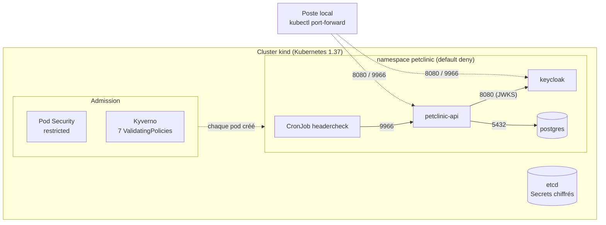

# k8s-secure-lab

[](https://github.com/omarsaidiA/k8s-secure-lab-o.s/actions/workflows/ci.yml)


Home lab Kubernetes durci : l'API [Omar-Petclinic](https://github.com/omarsaidiA/Omar-Petclinic),
son PostgreSQL et son Keycloak tournent dans un cluster [kind](https://kind.sigs.k8s.io/) où
**chaque contrôle de sécurité est prouvé par un test**, et pas seulement configuré. Le même
scénario tourne dans le CI à chaque push.

## Architecture



Seuls les flux fléchés sont autorisés : tout le reste est bloqué par les NetworkPolicies.

## Contrôles de sécurité

| Couche | Contrôle | Pourquoi | Prouvé par |
|---|---|---|---|
| Données | **Chiffrement des Secrets dans etcd** (secretbox, clé générée localement, jamais commitée) | Une sauvegarde ou un accès disque à etcd ne révèle pas les mots de passe | `verify.sh` lit etcd directement : préfixe `k8s:enc:secretbox:v1` |
| Admission | **Pod Security « restricted »** sur le namespace, version figée | Refuse root, `privileged`, l'élévation de privilèges, les capabilities et l'accès à l'hôte | Pods `privileged` et `runAsUser: 0` refusés |
| Admission | **Kyverno** (policy-as-code, CEL) | Couvre ce que Pod Security ne voit pas | 7 refus testés en cluster, 18 tests hors cluster |
| Réseau | **NetworkPolicies default deny**, puis un flux autorisé par besoin | Un pod compromis ne peut pas joindre la base ni les autres services | Un pod sonde résout les noms (DNS autorisé) mais ne peut ouvrir aucune connexion |
| Identité | **Aucun token Kubernetes monté** (`automountServiceAccountToken: false`) | Un token volé sert souvent à se déplacer dans le cluster | Refusé par Kyverno |
| Conteneurs | Non-root, `readOnlyRootFilesystem`, `drop: [ALL]`, seccomp `RuntimeDefault` | Limite ce qu'un attaquant peut faire après une exécution de code | Pod Security et Kyverno |
| Disponibilité | Requests, limite mémoire, probes | Un pod ne peut pas épuiser le nœud ; un pod cassé est redémarré | Refusé par Kyverno |
| Application | OAuth2/JWT Keycloak et RBAC d'Omar-Petclinic | — | 401 sans token, 403 VET qui supprime, 403 BOLA OWNER |
| Surveillance | **CronJob headercheck** ([mon outil](https://github.com/omarsaidiA/headerchecker)) qui audite l'API depuis le cluster | Une régression des en-têtes de sécurité fait échouer le job | Job lancé et réussi dans `verify.sh` |

### Policies Kyverno

| Policy | Refuse |
|---|---|
| [`disallow-latest-tag`](policies/disallow-latest-tag.yaml) | Une image sans tag, ou en `:latest` |
| [`restrict-image-registries`](policies/restrict-image-registries.yaml) | Une image hors liste blanche (`postgres`, `quay.io/keycloak/`, `lab.local/`) |
| [`require-resources`](policies/require-resources.yaml) | Un conteneur sans requests CPU/mémoire ou sans limite mémoire |
| [`require-readonly-rootfs`](policies/require-readonly-rootfs.yaml) | Un système de fichiers racine inscriptible |
| [`disallow-service-account-token`](policies/disallow-service-account-token.yaml) | Un pod qui monte un token d'API Kubernetes |
| [`require-probes`](policies/require-probes.yaml) | Un Deployment, StatefulSet ou DaemonSet sans readiness et liveness probes |
| [`require-namespace-pod-security`](policies/require-namespace-pod-security.yaml) | Un namespace créé sans Pod Security `baseline` ou `restricted` |

Les règles sur les pods s'appliquent aussi aux init containers, et Kyverno les étend
automatiquement aux Deployments, StatefulSets, Jobs et CronJobs (*autogen*) : l'erreur apparaît
dès le `kubectl apply`, pas plus tard quand le pod n'arrive pas à démarrer.

## Démarrage

Prérequis : Docker, [kind](https://kind.sigs.k8s.io/docs/user/quick-start/#installation) 0.33,
`kubectl`, `openssl` et `curl`. Environ 6 Go de mémoire pour Docker.

```bash
bash scripts/up.sh       # cluster, Kyverno, images, secrets et déploiement (~10 min la première fois)
bash scripts/verify.sh   # teste chaque contrôle de sécurité
bash scripts/down.sh     # supprime le cluster
```

`up.sh` vérifie le SHA-256 du manifeste d'installation de Kyverno, construit l'image
Omar-Petclinic depuis un commit figé et l'image headercheck depuis un commit figé. Les mots de
passe PostgreSQL et Keycloak sont générés aléatoirement dans des Secrets : ils n'apparaissent
nulle part dans le dépôt.

Accès local, puis connexion avec un utilisateur de test (**dev only**, défini dans le realm) :

```bash
kubectl -n petclinic port-forward svc/keycloak 8080:8080 &
kubectl -n petclinic port-forward svc/petclinic-api 9966:9966 &
```

## Pipeline CI

| Job | Contenu |
|---|---|
| Static | kubeconform (schémas Kubernetes et CRD Kyverno), `kyverno test` (18 cas bons et mauvais), ShellCheck, Trivy config (SARIF dans l'onglet *Security*, échec sur HIGH/CRITICAL) |
| End-to-end | Cluster kind éphémère, `up.sh` puis `verify.sh` : chaque contrôle est rejoué sur un vrai cluster |

Les outils sont téléchargés en version fixe et vérifiés par SHA-256 ; les actions GitHub sont
épinglées par SHA de commit ; Dependabot propose les mises à jour avec une période de *cooldown*.

## Choix et risques acceptés

- **Keycloak en lecture seule** : Keycloak reconstruit son jar au démarrage dans `lib/quarkus`.
  Plutôt qu'une exception à la policy, un init container copie ce dossier dans un `emptyDir`.
- **Realm Keycloak en Secret** et non en ConfigMap : il contient les mots de passe des
  utilisateurs de test (constat Trivy KSV-01010 corrigé).
- **Pas de limite CPU** : elle ralentit la JVM sans protéger le nœud ; la limite mémoire, elle,
  est obligatoire. Ce choix et les autres constats Trivy acceptés sont justifiés un par un dans
  [`.trivyignore`](.trivyignore).
- **Clé de chiffrement sur le disque du nœud** : suffisant pour un lab. En production, un
  fournisseur KMS garde la clé hors du cluster.
- **Keycloak `start-dev`** (HTTP, base embarquée) et **pas d'Ingress ni de TLS** : l'accès passe
  par `port-forward`, qui n'expose rien sur le réseau.
- **Kyverno lui-même est très privilégié** : Trivy signale sur son manifeste d'installation des
  droits CRITICAL (gestion des webhooks d'admission) et HIGH. C'est inhérent à un moteur
  d'admission : il doit voir et pouvoir bloquer chaque requête. Le risque est réduit en
  installant une version figée dont le SHA-256 est vérifié, et en l'excluant de ses propres
  policies plutôt qu'en l'affaiblissant.

## Licence

[MIT](LICENSE)
